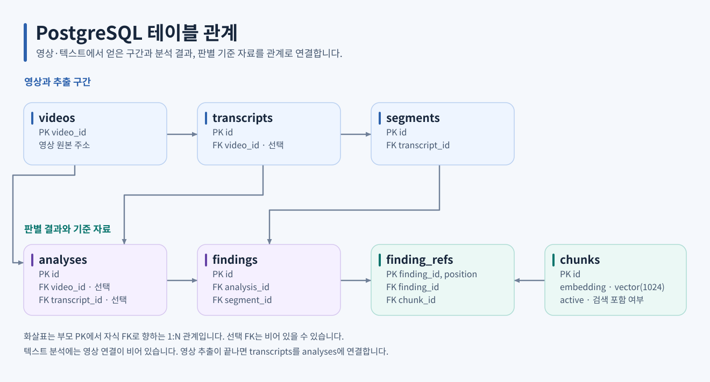

# 데이터베이스 구조

DBMS는 **PostgreSQL**입니다. 로컬은 PostgreSQL 17, 스테이징은 Supabase PostgreSQL을 사용합니다. `pgvector`로 기준 자료와 영상 대주제의 1024차원 임베딩을 저장하고 검색합니다. [스키마 원본](../backend/app/db/schema.sql)

## 테이블 관계

- 영상 한 편에는 여러 추출 결과와 분석이 연결될 수 있습니다. 텍스트 분석도 `transcripts`와 `segments`를 사용하며 `video_id`는 비어 있습니다.
- 적발 발언은 분석(`analyses`)과 원문 구간(`segments`)을 참조합니다. `finding_refs`는 적발 발언과 근거 자료(`chunks`)의 다대다 관계를 연결합니다.

## 테이블과 컬럼

### `videos` · 유튜브 영상

영상 분석을 처음 요청하면 영상 ID와 주소를 저장합니다. 추출이 끝나면 제목과 재생 시간을 채우며, 저장된 영상 결과와 관련 영상 목록에서 읽습니다.

| 컬럼 | 타입 | 저장값 |
| --- | --- | --- |
| `video_id` | text · PK | 유튜브 영상 ID. 주소 형식이 달라도 같은 영상을 같은 ID로 식별 |
| `url` | text | 처음 입력한 영상 주소 |
| `title` | text | 영상 제목 |
| `duration` | integer | 영상 길이(초) |
| `created_at` | timestamptz | 영상 레코드를 처음 만든 시각 |

### `transcripts` · 추출 결과

영상의 텍스트 추출이 끝나거나 텍스트 분석을 접수할 때 한 행을 저장합니다. 재분석에서 기존 추출 결과를 찾고, 영상 대주제와 비슷한 영상 목록을 표시할 때 읽습니다.

| 컬럼 | 타입 | 저장값 |
| --- | --- | --- |
| `id` | uuid · PK | 추출 결과 ID |
| `video_id` | text · FK → `videos.video_id` | 영상 ID. 직접 입력한 텍스트면 `NULL` |
| `warnings` | text[] | 일부 텍스트 추출이 실패한 이유 |
| `automatic_speech` | boolean | 자동 출처 선택을 사용했는지 여부. 재분석에서 같은 모드의 추출 결과를 선택하는 데 사용 |
| `topic_title` | text | 영상 대주제 제목 |
| `topic_summary` | text | 영상 대주제 요약 |
| `topic_keywords` | text[] | 대주제 키워드 목록 |
| `topic_embedding` | vector(1024) | 비슷한 영상의 대주제를 검색하는 벡터 |
| `created_at` | timestamptz | 추출 결과를 저장한 시각 |

### `segments` · 원문 구간

추출하거나 입력한 문장을 구간별로 저장합니다. 판별 엔진이 문맥을 만들 때 읽으며, 화면에서는 원문과 적발 발언의 출처·시각을 표시할 때 읽습니다.

| 컬럼 | 타입 | 저장값 |
| --- | --- | --- |
| `id` | bigserial · PK | 구간 ID |
| `transcript_id` | uuid · FK → `transcripts.id` | 구간이 속한 추출 결과 |
| `position` | integer | 추출 결과 안의 구간 순서 |
| `source` | text | `caption`(자막), `stt`(음성), `ocr`(화면 글자), `user`(직접 입력) |
| `time` | text | 영상 시각. 예를 들어 `02:15`. 직접 입력이면 `NULL` |
| `text` | text | 구간의 원문 |

### `analyses` · 분석 작업과 판별 결과

새 텍스트·영상 분석 작업을 시작할 때 한 행을 만들고 진행 상태와 최종 판별을 갱신합니다. 상태 조회와 결과 화면에서 읽으며, 같은 영상·출처·판별 버전의 완료 결과를 재사용할 때도 조회합니다.

| 컬럼 | 타입 | 저장값 |
| --- | --- | --- |
| `id` | uuid · PK | 화면과 API에서 쓰는 분석 ID |
| `video_id` | text · FK → `videos.video_id` | 대상 영상 ID. 텍스트 분석이면 `NULL` |
| `transcript_id` | uuid · FK → `transcripts.id` | 판별에 쓴 추출 결과. 영상 추출 중에는 `NULL`일 수 있음 |
| `sources` | text[] | 요청한 출처 목록. 영상에서 자동 출처를 선택하면 빈 배열 |
| `version` | text | 기준 자료, 프롬프트, 모델 설정과 엔진 리비전을 반영한 판별 버전 |
| `status` | text | `pending`, `running`, `done`, `failed` |
| `progress` | text | 현재 진행 단계 |
| `log` | text[] | 처리 순서대로 쌓이는 진행 메시지 |
| `log_times` | timestamptz[] | 진행 메시지의 기록 시각. 이전 데이터의 일부 메시지에 시각이 없으면 `log` 끝에서부터 대응 |
| `error` | text | 작업 실패 이유 |
| `verdict` | text | `safe`, `caution`, `danger` |
| `score` | integer | 종합 의심 점수(0~100) |
| `summary` | text | 판별 요약 |
| `created_at` | timestamptz | 분석 요청 시각 |

### `findings` · 적발 발언

판별이 끝나면 적발 발언마다 한 행을 저장합니다. 결과 화면에서 적발 문장, 점수, 판별 이유와 반증을 표시할 때 읽고, `segments`에서 영상 시각과 출처를 가져옵니다.

| 컬럼 | 타입 | 저장값 |
| --- | --- | --- |
| `id` | bigserial · PK | 적발 발언 ID |
| `analysis_id` | uuid · FK → `analyses.id` | 적발이 속한 분석 |
| `position` | integer | 분석 결과 안의 적발 표시 순서 |
| `segment_id` | bigint · FK → `segments.id` | 발언이 나온 원문 구간 |
| `quote` | text | 적발 발언 인용문 |
| `score` | integer | 발언별 의심 점수 |
| `group_name` | text | 관련 사례의 단체명 |
| `topic` | text | 교리 분류. 예를 들어 `christology` |
| `reason` | text | 발언이 기준 교리와 어긋난다고 판단한 이유 |
| `orthodox_refutation` | text | 정통 교리에 따른 반증 |
| `heresy_intent` | text | 비교 대상 사례의 교리 의도 |
| `scripture` | text[] | 관련 성경 구절 목록 |

### `finding_refs` · 적발 발언과 근거 연결

적발에 사용한 기준 자료 ID를 저장합니다. 결과 화면은 근거의 표시 순서를 따라 `chunks`를 조회해 제목과 발췌를 구성합니다.

| 컬럼 | 타입 | 저장값 |
| --- | --- | --- |
| `finding_id` | bigint · PK 일부 · FK → `findings.id` | 근거가 연결된 적발 발언 |
| `position` | integer · PK 일부 | 적발 한 건에서 근거의 표시 순서 |
| `chunk_id` | text · FK → `chunks.id` | 근거로 연결된 기준 자료 |

### `chunks` · 판별 기준 자료

기준 자료 적재 작업이 `data/`의 교리 조항과 사례, 임베딩을 저장합니다. 판별 엔진은 `active = true`인 자료를 종류별로 유사도 순서로 읽으며, 결과 화면은 이 테이블에서 근거 문서를 가져옵니다.

| 컬럼 | 타입 | 저장값 |
| --- | --- | --- |
| `id` | text · PK | 원본 기준 자료 ID. 예를 들어 `wsc-33` |
| `kind` | text | `orthodox`(정통 교리) 또는 `heresy`(이단 사례) |
| `text` | text | 임베딩에 사용한 교리 원문 또는 사례의 주장과 키워드 |
| `metadata` | jsonb | 출처, 교리 분류, 관련 성경 구절, 검증 여부 등 원본 자료 정보. 사례에는 의도·반증도 포함 |
| `embedding` | vector(1024) | Voyage로 만든 텍스트 임베딩 |
| `active` | boolean | 판별 검색에 포함할지 여부. 원본에서 빠진 자료는 이전 결과의 근거를 보존하며 비활성화 |
