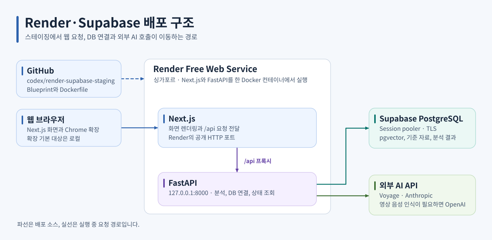

# Render·Supabase 스테이징

스테이징은 Render의 싱가포르 Free Web Service 하나에 Next.js와 FastAPI를 배포합니다. Next.js가 외부 HTTP 요청을 받고 `/api` 요청을 컨테이너 안의 `127.0.0.1:8000`으로 전달합니다. FastAPI는 Supabase PostgreSQL의 Session pooler에 연결하고, 분석할 때 Voyage와 Anthropic API를 호출합니다.



## 배포 파일

Render가 추적하는 브랜치는 `codex/render-supabase-staging`입니다. [Blueprint](https://github.com/wnsrlf0721/detect_heresy/blob/codex/render-supabase-staging/render.yaml) · [Dockerfile.render](https://github.com/wnsrlf0721/detect_heresy/blob/codex/render-supabase-staging/Dockerfile.render) · [시작 스크립트](https://github.com/wnsrlf0721/detect_heresy/blob/codex/render-supabase-staging/docker/start-render.sh)

| 설정 | 값 |
| --- | --- |
| Render 서비스 유형 | Free Web Service |
| 런타임 | Docker, 빌드 컨텍스트는 저장소 루트 `.` |
| 상태 확인 경로 | `/api/health` |
| 자동 배포 | 꺼짐. 브랜치를 갱신한 후 Render에서 수동 배포 |
| 공개 주소 | Render의 해당 서비스 **Overview** 화면에서 확인 |

## 연결 및 재배포

1. Supabase 프로젝트의 **Connect → Session pooler**에서 `postgresql://` 연결 문자열을 확인합니다. `[YOUR-PASSWORD]`를 해당 프로젝트의 DB 비밀번호로 바꾸고 TLS 연결 설정을 사용합니다. [Supabase 연결 안내](https://supabase.com/docs/guides/database/connecting-to-postgres)
2. Render에서 **서비스 → Environment → Environment Variables**를 엽니다. 기존 키의 값을 변경하거나 **Add variable**로 추가합니다. [Render 환경 변수 안내](https://render.com/docs/configure-environment-variables)
3. 기존 이미지에 환경 변수 변경만 적용할 때는 **Save and deploy**, 코드를 다시 빌드할 때는 **Save, rebuild, and deploy**를 선택합니다. 배포가 `Live`에 도달하면 아래 검증을 진행합니다.

| 환경 변수 | 역할 |
| --- | --- |
| `DATABASE_URL` | Supabase PostgreSQL Session pooler 연결 문자열 |
| `VOYAGE_API_KEY` | 기준 자료 적재와 검색 임베딩 |
| `ANTHROPIC_API_KEY` | 텍스트 판별, 영상 대주제 요약과 화면 글자 인식 |
| `OPENAI_API_KEY` | 영상에서 음성 인식이 필요한 경우에 사용 |

접속 문자열과 키는 Render 서비스의 환경 변수에 입력합니다. 시작 스크립트는 이 값을 FastAPI에서 사용하고 Next.js 프로세스에는 전달하지 않습니다. 분석을 시작하는 API는 현재 로그인 없이 요청을 받을 수 있으므로, 스테이징에 실제 과금 키를 쓰는 동안 호출량을 확인하고 공개 운영 전 인증과 사용량 제한을 추가합니다. 브라우저로 공개되는 `NEXT_PUBLIC_*`, GitHub 커밋과 빌드 로그에는 비밀값을 넣지 않습니다.

## 기준 자료 적재

FastAPI가 시작할 때 Supabase에 `vector` 확장과 테이블을 초기화합니다. 새 DB를 사용하거나 `data/`의 교리 자료를 갱신했을 때는 기준 자료 청크와 임베딩을 따로 적재합니다. Render Free 서비스에는 Shell과 one-off job이 제공되지 않으므로 로컬에서 실행합니다. [Render 무료 인스턴스 제한](https://render.com/docs/free)

같은 셸에서 Supabase의 `DATABASE_URL`과 `VOYAGE_API_KEY`를 환경 변수로 설정하고 저장소 루트에서 실행합니다. 이 명령은 Voyage API를 호출합니다.

```sh
cd backend
uv run --locked --no-dev python -m scripts.ingest
```

명령이 출력하는 적재 건수를 확인하고, [DB 문서의 조회](DATABASE.md#supabase-스테이징)로 `chunks`의 활성 행이 있는지 확인합니다. `scripts.ingest`는 같은 ID를 갱신하고 YAML에서 빠진 자료는 비활성화합니다. 이전 분석이 참조하는 행은 보존됩니다.

## 검증과 현재 상태

- Render **Events**에서 최신 배포가 `Live`인지 확인합니다. 서비스의 `/api/health`에서 HTTP 200과 `{"status":"ok"}`를 확인합니다.
- Render **Logs**에서 FastAPI 시작 시 `database.ready`가 기록됐는지 확인합니다.
- 웹에서 짧은 문장 한 건을 분석합니다. 요청 접수 후 저장된 결과의 상태가 `done`인지 확인하고, 진행 과정의 `비슷한 기준 자료 …건`에 검색 건수가 표시되는지 확인합니다.

2026년 11월 25일 검증에서는 `/api/health`, Voyage 임베딩, Anthropic 판별과 Supabase에 저장된 텍스트 결과 조회가 성공했습니다. 그 테스트에서 검색된 기준 자료는 0건이라, 기준 자료 적재 후 근거가 포함된 분석을 다시 확인해야 합니다. Render에서 유튜브 다운로드부터 영상 분석까지 이어지는 흐름도 별도 확인이 필요합니다.

| 증상 | 확인할 것 |
| --- | --- |
| `/api/health`가 실패함 | Render **Logs**에서 FastAPI 시작 오류와 `DATABASE_URL`의 프로젝트·풀러·비밀번호 확인 |
| 분석이 시작되지 않음 | `VOYAGE_API_KEY`, `ANTHROPIC_API_KEY`가 적용된 배포인지와 API 오류 로그 확인 |
| 기준 자료 검색이 0건 | `scripts.ingest`가 Render와 같은 Supabase 프로젝트를 대상으로 실행됐는지 확인 |
| 재배포 후 작업이 `failed`로 바뀜 | 진행 중이던 `BackgroundTasks`는 프로세스 재시작 때 중단되므로 분석을 다시 요청 |
