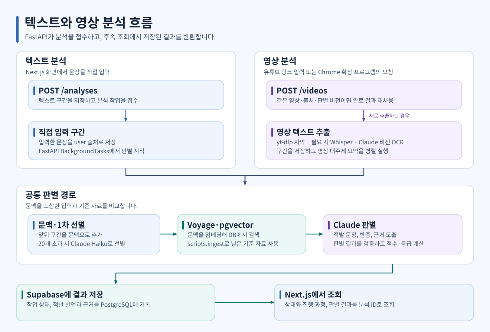

# Detect Heresy 프로젝트

유튜브 영상이나 텍스트를 정통 개신교 교리 자료와 비교해 의심 구간과 판별 근거를 보여 주는 서비스입니다. 기준 자료는 원출처 검증 전 초안이며, 결과는 참고용입니다.

## 현재 구현

| 구성 | 역할 |
| --- | --- |
| Next.js | 영상 링크·텍스트 입력, 분석 진행 상황, 결과·근거 표시 |
| Chrome 확장 프로그램 | 유튜브 재생을 감지해 영상 분석을 요청하고 저장된 결과를 웹 화면에서 열기 |
| FastAPI | 요청을 접수한 뒤 `BackgroundTasks`로 추출과 분석 실행, 상태와 저장된 결과 조회 |
| yt-dlp · Whisper · Claude 비전 | 영상과 자막 다운로드, 필요 시 음성 인식, 화면 글자 추출 |
| Voyage · Claude | 검색 임베딩, 긴 입력의 의심 구간 선별, 교리 비교·판별과 영상 대주제 요약 |
| PostgreSQL · pgvector | 기준 자료 임베딩, 영상·텍스트 추출 구간, 작업 상태와 결과 저장 |



텍스트 분석과 영상 분석은 각각 `POST /analyses`와 `POST /videos`에서 접수합니다. 화면은 작업 상태를 조회하다가 결과를 가져옵니다. 영상의 자막·음성·화면 글자에서 얻은 구간을 저장하며, 자동 출처 선택에서 사용할 수 있는 수동 한국어 자막이 있으면 음성 인식을 건너뜁니다. 영상 대주제 요약은 판별과 병렬로 처리합니다.

판별 엔진은 앞뒤 문맥을 붙인 구간을 Voyage로 임베딩하고 pgvector에서 기준 자료를 검색합니다. 구간이 20개를 넘으면 Claude Haiku로 의심 구간을 먼저 고릅니다. Claude 판별 뒤에는 결과와 근거를 저장합니다. 같은 영상·출처·판별 버전의 완료 결과는 재사용하며, 버전이 바뀌면 기존 추출문을 재사용해 판별할 수 있습니다.

로컬은 Docker Compose를 사용합니다. 스테이징은 Render Free Web Service 안에서 Next.js와 FastAPI를 실행하고, DB는 Supabase PostgreSQL에 둡니다. [배포 구조와 확인 절차](DEPLOYMENT.md) · [DB 구조](DATABASE.md)

현재 작업은 FastAPI 프로세스 안에서 실행되어 배포나 재시작 때 진행 중인 작업이 끊길 수 있습니다. 자막 스크린샷 업로드, 전체 분석 기록 목록, 사용자 피드백과 별도 워커 큐는 후속 범위입니다.

## 초기 기획 기록

<details>
<summary>초기 요구사항과 기술 후보</summary>

> **Project Overview:** 유튜브 영상 URL이나 미디어를 입력받아 영상 내 음성(STT), 텍스트(OCR), 이미지 등을 AI로 분석하고, 정통 기독교 신학 데이터베이스(RAG)와 비교하여 이단성 여부 및 판별 근거를 스코어링하여 보여주는 웹 서비스
> 

---

### 프로젝트의 핵심 가치

- **기술을 통한 신앙 보호:** 말씀에 대한 갈급함으로 영상을 찾는 이들이 자신도 모르게 잘못된 교리에 세뇌되는 것을 방지합니다.
- **객관적 근거 제시:** 단순히 "이단이다"라고 치부하는 것이 아니라, 수집된 텍스트와 정통 개신교 신학 이론을 AI가 정밀 비교하여 어떤 문장이 왜 정통 교리에 위배되는지 명확한 반증 근거를 제공합니다.

## 📌 Phase 1: 요구사항 정의 및 핵심 아키텍처 설계

AI 모델을 처음부터 학습시키는 것은 불가능하므로, 백엔드 엔지니어의 강점을 살려 
**Pre-trained AI API와 RAG(Retrieval-Augmented Generation) 아키텍처**를 활용한 파이프라인을 설계합니다.

### 1. 데이터 수집 파이프라인 (Data Ingestion Pipeline)

- **Video Downloader:** 유저가 유튜브 링크를 입력하면 영상/음원 파일을 추출 (예: `yt-dlp` 라이브러리 활용)
- **Audio To Text (STT):** 오디오에서 음성 추출 및 타임스탬프 기록
- **Image To Text (OCR):** 영상 내 자막, 성경 구절, ppt 화면 이미지에서 텍스트 추출

### 2. AI 판별 및 추론 엔진 (AI & RAG Engine)

- **Vector DB:** 정통 교리 데이터와 이단(신천지, 구원파 등)의 핵심 교리 키워드/사례집을 벡터화하여 저장
- **LLM Reasoning:** 수집된 영상 텍스트와 Vector DB의 레퍼런스를 비교 분석하여 이단 의심률(%)과 근거 도출

---

## 📌 Phase 2: 기술 스택 선정 (Tech Stack)

기존의 백엔드 지식을 활용하면서 AI 기능을 빠르게 붙일 수 있는 스택으로 구성합니다.

| 레이어 | 추천 기술 스택 | 비고 / 역할 |
| --- | --- | --- |
| **Frontend** | React.js / Next.js | 분석 결과 대시보드, 타임스탬프별 의심 구간 시각화 |
| **Backend** | Python (FastAPI / Django) | AI 및 데이터 파이프라인 연동에 최적화된 백엔드 |
| **비동기 큐** | Celery + Redis | 영상 분석은 시간이 걸리므로 비동기 작업(Task) 처리 필수 |
| **STT Engine** | OpenAI Whisper API | 한국어 음성 인식률이 가장 뛰어남 (또는 open-source Whisper) |
| **OCR Engine** | Google Cloud Vision / EasyOCR | 영상 속 자막 및 성경 구절 텍스트 추출 |
| **Vector DB** | Pinecone / Chroma / Milvus | 정통 신학 자료 및 이단 교리 임베딩 데이터 저장 |
| **Main LLM** |  | 수집된 데이터와 데이터베이스를 비교 분석하는 두뇌 역할 |

---

## 📌 Phase 3: 단계별 구축 가이드 (Step-by-Step)

### 1단계: 신학적 기준 데이터 구축 (가장 중요)

AI가 '기준'을 알기 위해서는 정통 기독교 신학 자료와 이단의 왜곡 사례 데이터가 필요합니다.

- **정통 신학 데이터 수집:** 주요 교단(통합, 합동 등)의 신앙고백서, 사도신경 해설, 표준 조직신학 자료.
- **이단 교리 및 반증 데이터 수집:** 한국기독교이단상담소협회(현대종교) 등의 이단 상담 자료, 신천지 주요 키워드 집합(예: 비유풀이 공식, 배멸구, 신인합일, 약속의 목자 등).
- **데이터 벡터화:** 위 문서들을 청크(Chunk) 단위로 쪼개어 Embedding 모델을 통해 Vector DB에 저장.

### 2단계: 미디어 전처리 및 텍스트 추출 기능 개발 (Backend)

- 유저가 입력한 URL의 영상을 백엔드 워커(Celery)가 할당받아 다운로드합니다.
- **음성 처리:** Whisper를 통해 텍스트화하고, `[{ "time": "02:15", "text": "이 땅 육의 세계의 천국이 되는 거겠죠" }]`와 같은 JSON 형태로 정형화합니다.
- **이미지 처리:** 특정 프레임마다 스크린샷을 확보하여 OCR로 자막이나 인용된 성경 구절을 텍스트로 추출합니다.

### 3단계: RAG 기반 이단성 판별 로직 구현 (AI)

- 추출된 영상 스크립트를 문단 단위로 LLM에게 보냅니다.
- **Prompt Engineering 예시:**
    
    ```
    [Role] 당신은 정통 개신교 이단 대책 위원회의 전문 위원입니다.
    [Task] 입력된 영상 스크립트가 정통 기독교 교리(삼위일체, 오직 은혜의 구원론)를 위배하거나, 특정 이단(예: 신천지의 비유풀이, 실상 교리)의 문맥을 포함하는지 분석하세요.
    [Context] {Vector_DB에서_검색된_관련_이단_사례_및_정통_교리_문서}
    [Input] {영상에서_추출된_스크립트_텍스트}
    [Output Format] JSON (의심 점수, 적발된 문장, 정통 교리와의 비교 분석 원인)
    ```
    

### 4단계: 결과 대시보드 웹 페이지 개발 (Frontend)

- **종합 의심 지수:** 안전 / 주의 / 위험 (퍼센트 게이지)
- **타임라인 뷰어:** 영상의 몇 분 몇 초에 이단적 발언(예: "보석은 말씀 가진 사람")이 나왔는지 하이라이트 표시
- **교리 비교 컴포넌트:** 영상 속 발언 ↔ 정통 기독교의 반증 ↔ 이단의 원래 의도(신천지 등)를 3단 테이블로 비교 제시

---

## 📌 Phase 4: 프로젝트 고도화 및 MVP 전략

1. **MVP(최소 기능 제품) 단계:** 우선은 영상 전체를 분석하기보다, 유저가 의심스러운 **'텍스트 문장'이나 '자막 스크린샷 이미지'를 업로드하면** RAG를 통해 이단 교리 여부를 판별해 주는 기능부터 시작하는 것을 추천합니다. (비동기 영상 처리 파이프라인의 복잡성을 줄일 수 있음)
2. **비용 최적화:** Whisper API와 GPT-4o API 비용을 고려하여, 영상 전체를 LLM에 태우기 전 **1차 키워드 필터링(Regex 혹은 가벼운 오픈소스 모델)**을 거쳐 의심 구간만 LLM RAG로 정밀 분석하는 구조를 취하면 비용을 획기적으로 줄일 수 있습니다.
3. **크라우드 소싱 정교화:** AI의 판별 결과가 100% 완벽할 수 없으므로, 유저들이 "이 판별이 맞다/틀리다"를 피드백할 수 있는 기능을 넣어 지속적으로 AI 프롬프트와 데이터베이스를 보정합니다.

</details>
